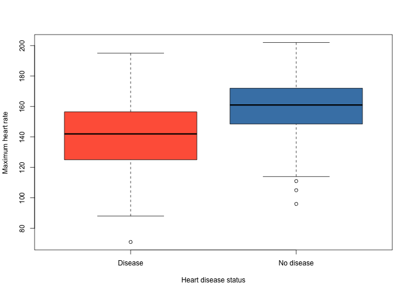

This report summarizes the UCI Cleveland heart disease data.

## Table

```{r, echo = FALSE}
knitr::kable(readRDS("output/table1.rds"),
             caption = "Mean values by heart disease status")
```

## Figure


